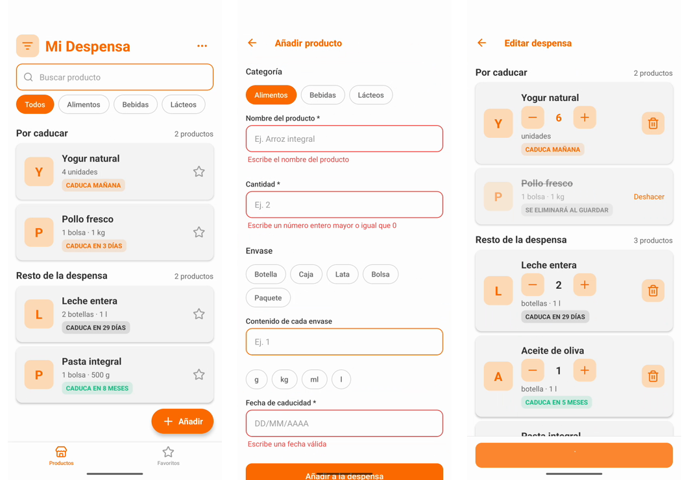

# MyBasket

A household supplies basket: keep track of the products you have in stock and their expiration dates, so nothing goes bad.

MyBasket is a **personal engineering project** built to explore how a mobile product is architected when React Native and native code have to live together. The product is intentionally small; the value is in the architecture, the engineering practices and the way AI tooling is used to build it.




## At a glance

| Area                 | What it demonstrates                                                                                                                             |
| -------------------- | ------------------------------------------------------------------------------------------------------------------------------------------------ |
| Architecture         | Monorepo of independent modules designed to be split into separate repositories, embedded in a native host app                                   |
| React Native         | React 19 + React Native 0.82 on the **New Architecture**, TypeScript, **TurboModule** with codegen, React Navigation inside an embedded feature  |
| Native Android       | Kotlin host app, Gradle Kotlin DSL, React Native Gradle plugin, Android Keystore (AES-GCM) encryption                                            |
| Design               | Ports and adapters, a design system with its own showcase app, pure domain rules, strict module boundaries                                       |
| Networking           | A typed API client over `fetch` that attaches the access token, maps every failure to a stable error code and talks to a real serverless backend |
| Security             | Encrypted session storage, https-only backend, no cleartext in release, backup exclusions, password policy                                       |
| Quality              | More than 300 Jest unit and contract tests, typed errors, strict TypeScript, Prettier, written clean-code rules                                  |
| AI-assisted workflow | Claude Code with project rules, reusable skills and a read-only security-audit subagent, all versioned in the repo                               |

## What the app does

- **Authentication** against a real backend: sign in, sign up with email confirmation, password recovery and reset. The session is stored encrypted, restored at startup and renewed before the access token expires.
- **Product inventory** with expiration date tracking:
  - the list groups products into the ones about to expire and the rest of the pantry, with a search box and category filters;
  - an add form with validation (required fields, whole-number counts, real calendar dates), where each product has a number of packages, an optional packaging and the optional content of each package ("2 bottles · 1 l");
  - an edit mode, opened from a menu in the header, to change the number of packages of several products and remove others, applied with one save;
  - pull to refresh, an empty state, and messages that say why a call failed (no connection, server down, invalid session).
- **Side menu** with the signed-in user and sign out.

The app talks to a separate serverless backend (a REST API behind API Gateway with Cognito authentication and DynamoDB), configured through `local.properties`.

## Architecture

The repository is an npm-workspaces monorepo. React Native screens and components are built as **reusable modules** that a **native host app** embeds. This is a **brownfield** setup: the native host owns the app and its navigation between screens, and React Native features are embedded one at a time, as happens when a company migrates an existing native app gradually instead of building a pure React Native app.

```
apps/
  host-android/          Native Android app (Kotlin + Gradle) that hosts React Native
modules/
  ui/
    ui-components/       Design system: tokens, theme and P-prefixed components
    ui-animation/        Animated components consuming the design tokens
  auth/
    auth-flow/           Login, sign up, recovery; session state; swappable backend
  data/
    api-client/          HTTP client: Bearer token, typed errors
  platform/
    secure-storage/      TurboModule: encrypted key-value storage (Kotlin native code)
  feature/
    feature-home/        Product list, add and edit products, with its own navigation
    feature-side-menu/   Side menu with the user and sign out
```

Each folder under `modules/` is a **family** that is meant to become its own repository later, and so is each host. To keep that split cheap, packages depend on each other **by name and semver range** (never `file:` or relative paths across families), and nothing imports across families through relative paths.

### Highlights

**`auth-flow`: ports and adapters behind a thin React layer.**
Layers are `domain` (types, typed `AuthError`, the `AuthProvider` and `SessionStorage` ports, validation), `data` (`RemoteAuthProvider`), `application` (`AuthService`, session reducer, `useAuth`) and `presentation` (screens and flows). The backend and the storage sit behind interfaces, so the mock and the real service are interchangeable with a one-line change in the host. A shared **contract test suite** runs against both the mock and the remote provider so they cannot drift apart. `AuthService` is plain TypeScript, so non-React code can ask it for a fresh access token.

**`api-client`: one place to talk to the backend.**
A single `fetch` wrapper that every feature uses. It attaches the access token, serializes and parses JSON, and turns every failure into an `ApiError` with a stable code (`unauthorized`, `not-found`, `validation`, `server`, `network`), reading both error shapes the backend returns. It does not depend on `auth-flow`: the host injects a `getAccessToken` function.

**`secure-storage`: a TurboModule with native code inside.**
A typed TypeScript contract feeds React Native codegen, which generates the native base class that the Kotlin module extends. Values are encrypted with an AES-GCM key that never leaves the Android Keystore. It is generic and does not depend on `auth-flow`: the host injects it into the auth module through a `KeyValueStore` port.

**`ui-components`: a design system as a library.**
Theme tokens (colors, spacing, typography, borders, shadows) and `P`-prefixed components (`PButton`, `PCard`, `PBadge`, `PInput`, `PLink`, `PIcon`, `PChip`, `PFab`, `PIconButton`, `PMenu`), built with `react-native-builder-bob` for ESM and CommonJS with generated types, and documented by an Expo showcase app.

**`feature-home`: an embeddable feature with its own navigation.**
One entry point (`HomeNavigator`) that owns a stack with tabs in its own React Navigation container, so the host does not know its routes. It does not depend on `auth-flow` or on other features; initial data comes in as props and leaving the feature is an event. The data comes through a `ProductRepository` port, and the rules (expiration status, grouping, filtering, form validation, the pending edits of the edit mode) are pure functions with unit tests. A failed repository call rejects with an error that carries a code, which the screens turn into a message. The architecture rule behind it records the references it is based on (React Native brownfield guidance, React Navigation docs and real feature-based apps) and the gaps no reference covered.

**`feature-side-menu`: a menu without a drawer library.**
A panel that slides over the screen, drawn in a `Modal` with `Animated` and the native driver, so it needs no navigation library and no native dependency. It receives the user's name and the sign out action as props, and the home only emits an event when its menu button is pressed: the host connects the two.

**`host-android`: a native host that opens React Native features.**
The native host owns navigation: `AuthActivity` shows the React Native login and, when the session opens, the coordinator moves to `HomeActivity`, which shows `feature-home` together with the side menu. Each destination is its own React Native root, registered by name, and they share one `AuthService` instance. The roots report `signedIn` and `signedOut` to native through a host-owned TurboModule. The host also holds the adapter that maps the backend's products to the home's model and its errors to the home's error codes, and it reads the backend addresses from the git-ignored `local.properties`.

## Tech stack

- **TypeScript**, **React 19**, **React Native 0.82** (New Architecture, Hermes)
- **Kotlin**, Gradle (Kotlin DSL), Android Gradle Plugin 8.12, JDK 17
- **Jest** for unit and contract tests, **Expo** for the component showcase apps
- **React Navigation** (`native-stack`, `bottom-tabs`) for the navigation inside a feature
- **react-native-builder-bob** to build the libraries, **Metro** configured for the monorepo
- **Android Keystore** for encryption at rest

## Engineering practices

- **Security by default.** Release builds disable cleartext traffic; the remote provider and the API client require an `https` endpoint; the encrypted session is excluded from Android backups; the React Native dev menu activity only exists in debug builds; an invalid configuration is reported on screen instead of crashing; credential and signing files are git-ignored; Keystore failures map to typed errors; a password policy is enforced on sign up; unconfirmed accounts cannot be pre-hijacked by resending sign up. Secrets never live in the repository, and every commit is checked for them first.
- **Session handling.** The session is restored at startup and renewed when the access token is about to expire, with a safety margin.
- **Typed errors end to end.** A transport failure becomes an `ApiError`, the host adapter turns it into a code the feature understands, and the screen shows a message for that cause, without any layer inspecting error strings.
- **Tested logic.** Domain rules, adapters and the session logic have unit tests, and the host adapter and the mapping of backend data are tested without a device. The flows were also checked end to end on an emulator against the real backend, including failures such as a cut network.
- **Documented decisions.** Module READMEs record _why_ a design was chosen, what it costs and when something simpler would be enough.
- **Clean code as a written rule.** Intent-revealing names, small single-purpose units, no dead code, no magic values, explicit error handling.
- **Small, reviewable changes.** Feature branches, pull requests, short past-tense commit messages.

## Working with AI

AI is treated as a team member that has to follow the project's engineering standards, not as an autocomplete. The setup is versioned in `.claude/`, so anyone cloning the repository gets the same behavior.

- **Project instructions** (`CLAUDE.md`): the product, the structure, the stack and the conventions the assistant must respect.
- **Architecture and quality rules** (`.claude/rules/`): clean code, auth-module architecture, feature-module architecture, design-system architecture, Kotlin/Android, React Native/TypeScript, Swift/iOS, security and git. Rules are scoped to the paths they apply to, so each one only loads when relevant.
- **Reusable skills** (`.claude/skills/`): repeatable workflows packaged as instructions.
  - `create-auth-module` scaffolds a new auth module that follows the architecture.
  - `create-design-system-module` scaffolds a new UI library.
  - `upgrade-react-native` bumps React Native across the monorepo and verifies the Android host with a script.
- **Specialized subagent** (`.claude/agents/security-reviewer`): an independent, read-only security auditor that checks the whole repository against the project's security rules and OWASP MASVS and reports unmet controls with `path:line` evidence. It never edits files; its findings drive the hardening commits.
- **Guardrails.** The assistant must ask for explicit authorization before every `git push`, scan every commit for secrets, and cannot write credentials into code or configuration.

The result is that the assistant accelerates the work while architecture, security and review decisions remain deliberate and verifiable. Using it well for a multi-module, multi-language codebase is part of what this project is meant to practice.

## Getting started

Requirements: Node.js, JDK 17, Android Studio with an emulator or a device.

```bash
npm install                      # installs every workspace

# Build a library (example: the design system)
npm run build --workspace modules/ui/ui-components

# Run the unit tests of a module
npm test --workspace modules/auth/auth-flow
npm test --workspace modules/feature/feature-home

# Run the Android host
cd apps/host-android
npm start                        # starts Metro
# then run the app from Android Studio, or ./gradlew installDebug
```

Copy `apps/host-android/local.properties.example` to `local.properties` and fill in the authentication client and endpoint and the API base URL of your backend; that file is git-ignored. Each module has its own `example/` showcase app (Expo) that can be run independently, for example the home feature on an in-memory repository:

```bash
cd modules/feature/feature-home/example
npm start
```
